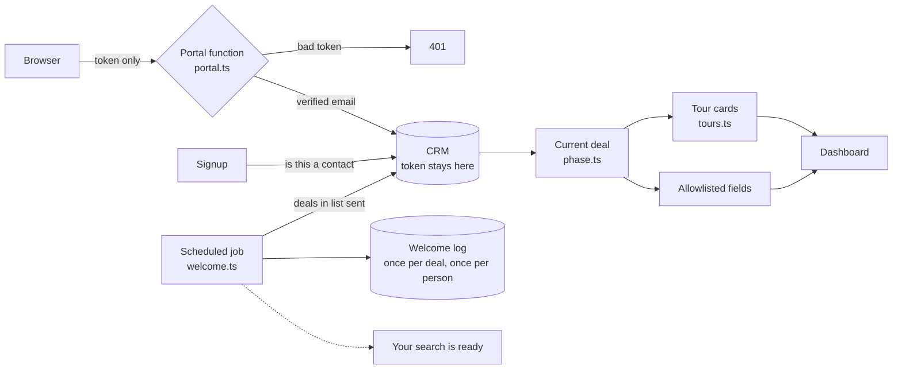

# client-portal

A client portal that reads live from the brokerage's CRM, without ever handing the browser the CRM token.

This is a standalone rebuild of a client platform I built and run for an apartment locating brokerage in Dallas, written the way I would build it today, with a fictional company (Northline Locating) so the design can be read in public. The production system is private; its numbers are below.

## The idea

An apartment locator runs every client through a CRM. She moves deals through stages, types tour schedules into a notes field, and pastes in the properties report. Clients, meanwhile, text her to ask where things stand. The portal answers that question: a client logs in and sees their search status, their tour schedule and their properties report, read live from the CRM.

The obvious build is to sync the CRM into a database and point a dashboard at it. That gives you two copies of the truth, and the broker's copy is the one that is right. So the portal keeps no copy of the search. One server function sits between the browser and the CRM, and the hard part is everything that function refuses to do:

| Decision | Made by | Why |
|---|---|---|
| Who is asking? | The verified token, never the request body | A logged in client can put anyone's email in a request |
| What do they see? | An allowlist of fields | The CRM record carries commission rates and internal notes; a field added tomorrow stays private until someone adds it on purpose |
| Can they sign up? | Only if their email is already a CRM contact, checked on the server | The portal is for clients, and the CRM is the list of clients |
| Which dashboard? | The current deal's stage, one mapping | The broker already maintains the stage; a second status would drift |
| What are the tour cards? | Rules over the broker's own notes, nothing dropped | She should not have to change how she writes for the software |
| Was the welcome sent? | A log table and unique indexes | The job runs every few minutes and can overlap itself |



## The production system

The private system this rebuild is based on serves an apartment locating brokerage in Dallas. As of October 5, 2026:

- 106 client accounts; signup asks HubSpot whether the email is a known contact before an account is created
- 91 welcome emails sent by the scheduled function since it went live in June 2026, every one logged
- Client dashboards read live from HubSpot through an authenticated Supabase edge function; the HubSpot token is a server secret and never reaches the browser
- Tour schedules typed as free text in HubSpot, shown to clients as structured tour cards
- Dashboard pages and copy (neighborhood guides, partner perks, checklists, reminders) edited by the brokerage in a Google Sheet, with no developer involved
- The welcome email replaced HubSpot automation. The brokerage was paying about $800 a month for HubSpot's automation tier; the email now runs as one edge function and a log table. HubSpot is not removed: it stays as the CRM at a baseline tier, and only the paid automation tier was dropped.

## Run it

```bash
npm install
npm run demo    # the whole portal against an in-memory CRM, no network, no keys
npm test        # 32 tests, including the schema against real Postgres (PGlite)
```

```
1. Signup is for clients only
  Ava.Chen@example.com          account u-1, CRM contact c-101
  curious.visitor@example.com   refused: not_a_client
  ava.chen@example.com          refused: already_registered

2. The CRM proxy
  no token                            401  sign in again
  forged token                        401  sign in again
  signed in, not in the CRM           404  no client record for this account
  Ava                                 200  Ava, searching, agent Jay Patel
  Ava, asking for Mara by email       200  Ava, searching, agent Jay Patel
  Mara                                200  Mara, lifestyle, agent Rosa Medina
  Ava is shown:          firstname, lastname, email, dealname, top_picks, report_link
  used on the server:    dealstage, createdate, tour_log, hubspot_owner_id
  never sent:            phone, lead_source, internal_notes, commission_rate
  verifyEmail ben.okoro@example.com   {"exists":true}
  verifyEmail someone@example.com     {"exists":false}

3. Ava's tour notes, as her broker typed them, and as cards
  | Saturday October 10th
  | Maple Row Lofts: 11am (ask about the corner unit)
  | The Ellsworth: 12:30pm
  | Cedar & Pine - 2pm
  | Trying to book Halden Park for Sunday at 4:30pm
  | * Bring a photo ID and your last two pay stubs
  Saturday October 10th
    11am    Maple Row Lofts  (ask about the corner unit)
    12:30pm The Ellsworth
    2pm     Cedar & Pine
    note: Trying to book Halden Park for Sunday at 4:30pm
    note: Bring a photo ID and your last two pay stubs

4. Welcome emails, one scheduled run at a time
  14:00:00  first run
            d-201  sent
            d-202  error: the contact on the deal has no email
            d-204  skipped_returning_client
            > to ava.chen@example.com: "Your search is ready"
            > to rosa@northline.example: "Welcome email failed: Dee Alvarez, 2 bed"
  14:00:30  30 seconds later
            d-202  cooling_down
  14:02:00  Dee's email added in the CRM
            d-202  sent
            > to dee.alvarez@example.com: "Your search is ready"
  14:04:00  next run
            nothing new

2 welcomes sent, 1 skipped, 1 alert, 0 duplicates
```

## What's where

| | |
|---|---|
| [src/portal.ts](src/portal.ts) | The CRM proxy: verify the token, find the caller's own contact, return an allowlist |
| [src/crm.ts](src/crm.ts) | The CRM interface, an in-memory `FakeCrm`, and `HubSpotCrm` over the HubSpot v3 API |
| [src/auth.ts](src/auth.ts) | Token verification: a stub for offline runs, Supabase Auth for real ones |
| [src/signup.ts](src/signup.ts) | Accounts for CRM contacts only, created on the server after the check |
| [src/phase.ts](src/phase.ts) | Stage to dashboard phase, and which of a returning client's deals is current |
| [src/tours.ts](src/tours.ts) | The broker's free text tour notes, as day cards, stops and notes |
| [src/welcome.ts](src/welcome.ts) | The welcome email job: idempotent, alerts once, retries on the broker's clock |
| [schema/001_portal.sql](schema/001_portal.sql) | Postgres: a client sees their own row, staff see theirs, server only tables, once only welcomes |
| [test/](test/) | The rules, the proxy and signup, the welcome job with a fake clock, and the schema as an ordinary database role |

## Choices worth defending

- **The CRM stays the system of record.** The portal reads it live and keeps no copy of the search. The broker never updates two places, and the client never sees a stale one.
- **Identity comes from the token, not the request.** The proxy looks up the caller's contact by the email Supabase Auth vouches for. An email or contact id in the body is ignored, and a test sends one to prove it.
- **Allowlists, not blocklists.** The CRM grows fields over time. A blocklist leaks the first one nobody thought about; an allowlist withholds it.
- **Signup is checked where it cannot be skipped.** The CRM lookup and the account creation happen together on the server, and the database has no insert policy for a signed in browser.
- **Rules for the tour notes, not a model.** The notes follow a small, stable grammar, and a line the rules cannot place is shown in the broker's own words. That is always correct, costs nothing, and never invents a tour.
- **The welcome job can run as often as it likes.** Every decision, including "skip, returning client", is logged, and two unique indexes make a double send impossible even when runs overlap. A failure alerts a person once, then retries quietly until the point where the broker would have reached the client herself.
- **Everything external is an interface.** `FakeCrm`, `StubVerifier` and `MemoryMailer` run the whole system with no network and no keys; `HubSpotCrm`, `SupabaseVerifier` and `ResendMailer` are the same interfaces for real.

Built by [Jeffrey Mailey](https://github.com/jmailey23), [Jump Automations](https://jumpautomations.com).
